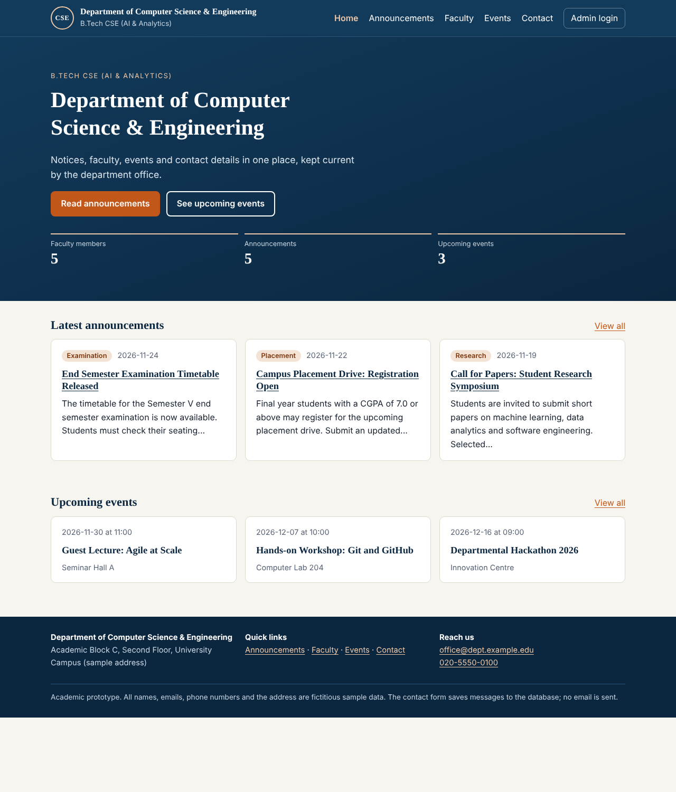
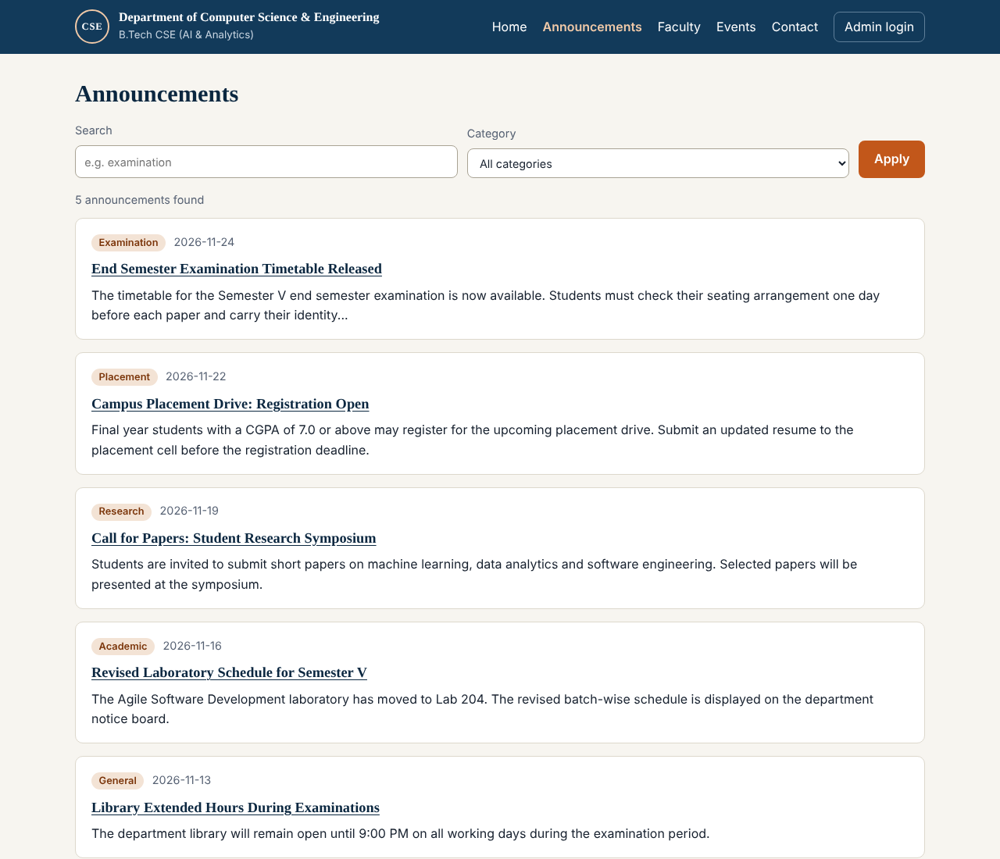
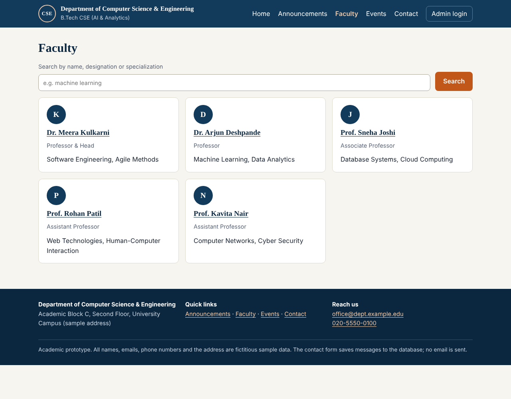
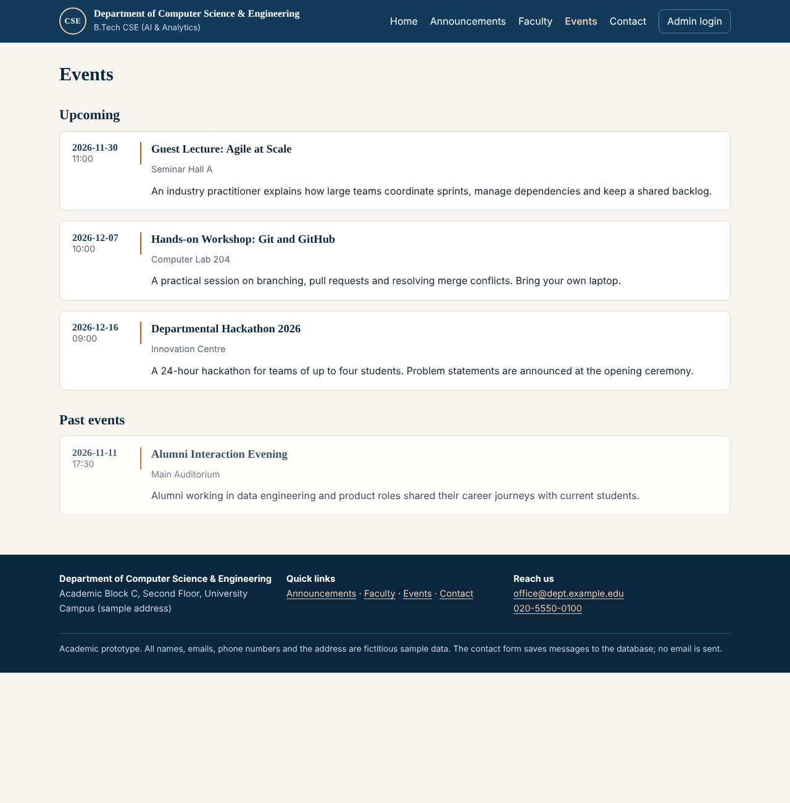
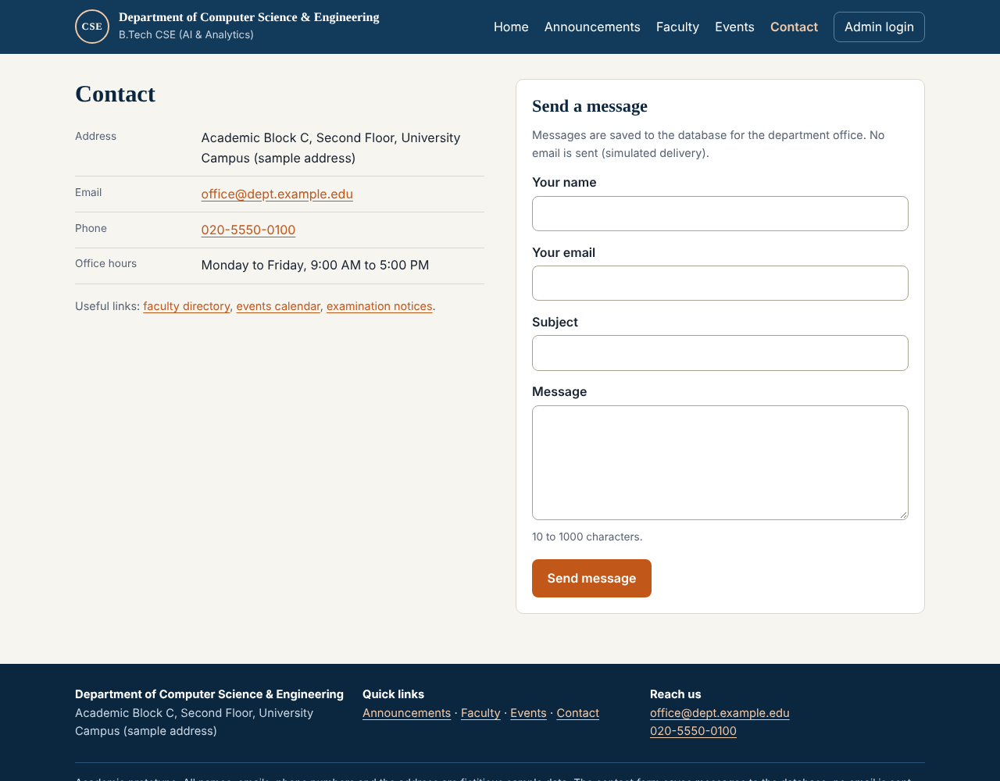
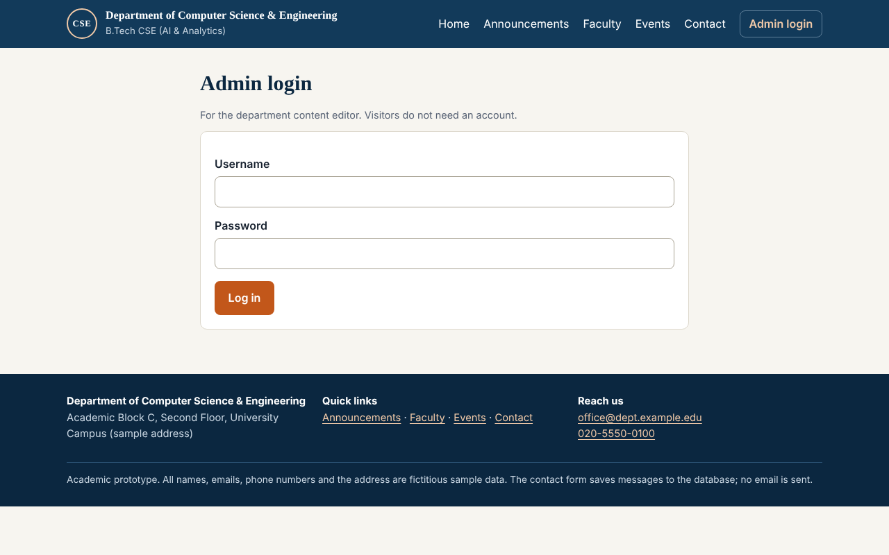
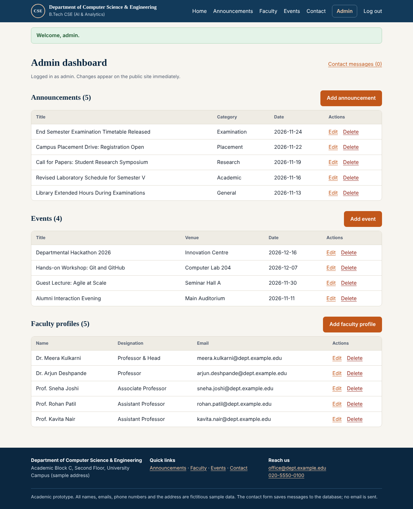
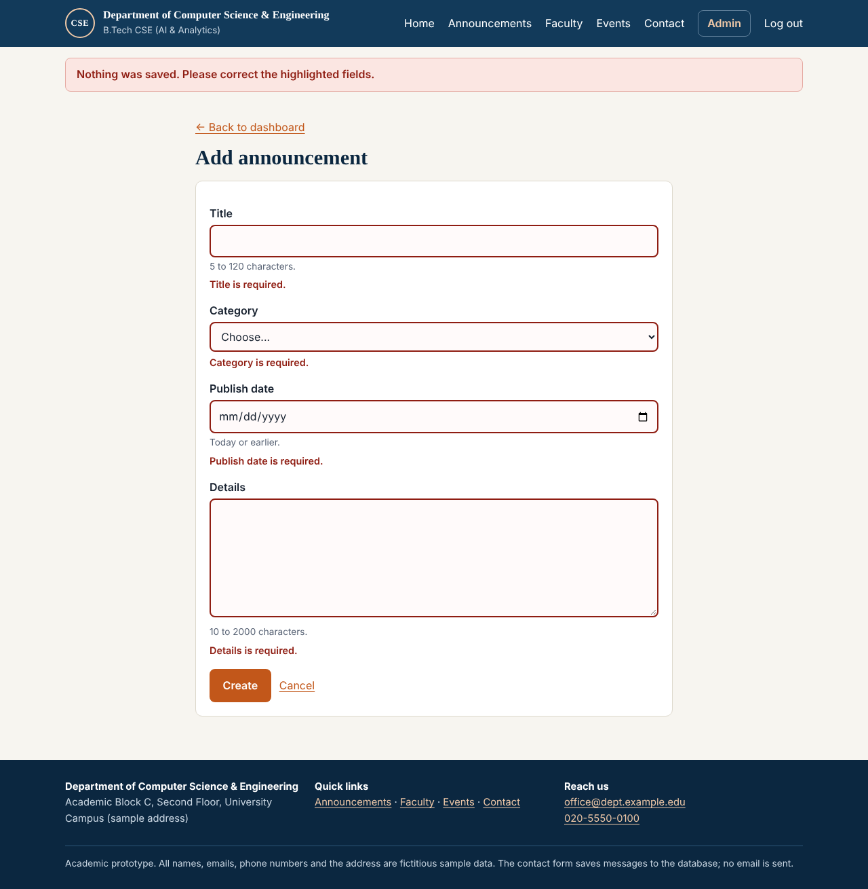
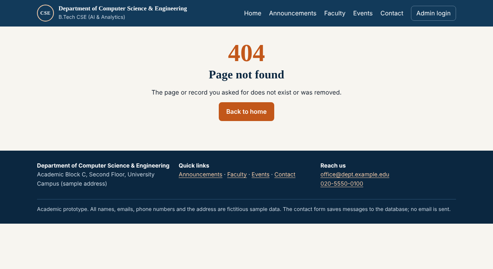

# Project Report: Department Website Revamp

Course: Agile Software Development (23CSE3012), Semester V, B.Tech CSE (AI & Analytics), AY 2026–27
Problem Statement 4: **Department Website Revamp – Agile vs Traditional**

Team: ________ (names and roll numbers)   GitHub: ________   Jira board: ________

## 1. Problem

The existing department website is hard to use on a phone, and its content goes stale because every change needs a developer. Students miss notices, and visitors cannot easily find faculty or contact details.

## 2. Users and solution

| User | Need | What the solution gives |
|---|---|---|
| Visitor (student, parent, applicant) | Find notices, faculty, events and contact details quickly on any device | Responsive public site with search |
| Admin / content editor (department office) | Publish and correct content without a developer | Login-protected dashboard to create, edit and delete content |

**Core workflow:** admin logs in → adds or updates an announcement or event → visitor opens the site → sees the change immediately.

## 3. Architecture

A classic three-layer web application running as one Python process.

```
 Browser (visitor or admin)
        |  HTTP request (GET a page, POST a form)
        v
 +-----------------------------------------------+
 | Flask application (app.py)                    |
 |  1. Routes: one function per page             |
 |  2. Security: login check, CSRF token         |
 |  3. validators.py: is the input acceptable?   |
 |  4. SQL queries with ? placeholders           |
 +-----------------------------------------------+
        |                              |
        v                              v
 SQLite database                Jinja2 templates
 (department.db, one file)      (templates/*.html + static/style.css)
        |                              |
        +-------> HTML page sent back to the browser
```

**What happens when the admin saves an announcement**
1. The browser sends `POST /admin/announcements/new` with the form fields and a hidden security token.
2. `check_csrf` confirms the token matches the one stored in the user's session. If not: 400.
3. `login_required` confirms the session belongs to a logged-in admin. If not: redirect to login.
4. `validate_announcement` trims the text and checks every rule. If any rule fails, the form is shown again with a message beside each wrong field, and nothing is saved.
5. `duplicate_error` checks whether the title already exists.
6. An `INSERT` runs and is committed. The database's own `UNIQUE` rule is a second safety net.
7. The browser is redirected to the dashboard with a green success message. The public pages read from the same database, so the visitor sees the change on the next page load.

## 4. Technology and reasons

| Layer | Technology | Reason |
|---|---|---|
| Back end | Python 3, Flask 3 | Small and readable; the whole server is one file the team can explain |
| Database | SQLite | A real relational database in a single file; nothing to install; works offline |
| Front end | HTML, CSS, Jinja2 templates | Pages are built on the server; no JavaScript framework to learn or break |
| Security | Werkzeug password hashing, signed session cookie, CSRF token | Standard protections with no extra library |
| Testing | pytest | Automated, repeatable, fast (under 5 seconds) |
| Version control | Git, GitHub | History of every change; GitHub Actions runs the tests on each push |
| Agile tool | Jira (Scrum board) | Backlog, sprints, story points, burndown and velocity charts |

## 5. Database design

Five tables (`schema.sql`).

```
admins(id PK, username UNIQUE, password_hash)

announcements(id PK, title UNIQUE, category, body, published_on, updated_at)

events(id PK, title, event_date, event_time, venue, description, updated_at,
       UNIQUE(title, event_date))

faculty(id PK, name, designation, email UNIQUE, phone, qualification,
        specialization, bio)

messages(id PK, name, email, subject, body, created_at)
```

- The tables are independent content types, so there are no foreign keys. Each is already in third normal form: every column depends only on the table's primary key.
- `UNIQUE` constraints enforce the duplicate rules inside the database itself, in addition to the checks in the application.
- Dates are stored as `YYYY-MM-DD` text, which sorts correctly as plain text.
- The admin password is stored only as a salted hash (scrypt, via Werkzeug). A hash is a one-way scramble: the login check hashes what was typed and compares; the original password cannot be read back from the database.

## 6. Validation rules

| Field | Rule |
|---|---|
| Title (announcement, event) | Required, 5 to 120 characters |
| Details / description | Required, 10 to 2000 characters |
| Category, designation | Must be one of the fixed options |
| Publish date | Real date, not in the future |
| Event date | Real date, not in the past (unless editing an old event without moving it), at most 2 years ahead |
| Event time | 24-hour HH:MM |
| Email | Valid format; unique for faculty |
| Phone | 10 digits starting with 6–9 |
| Duplicates | Announcement title; event title + date; faculty email |
| Contact message | Name 3–80, subject 5–120, message 10–1000 characters |

Error handling: custom pages for 400, 404, 405, 413 and 500, so a visitor never sees a technical error screen.

## 7. Agile vs Traditional for this project

| Aspect | Traditional (Waterfall) | Agile (Scrum), as used here |
|---|---|---|
| Requirements | All pages and rules fixed in a signed-off document before any code | Backlog of user stories, re-ordered before each sprint |
| First working software | After design and build phases finish, near the end | End of Sprint 1: the public site already runs |
| Feedback from the department | At final acceptance | At every sprint review |
| Change (e.g. "add a contact form") | Formal change request; re-plan; date slips | New story, estimated and ordered; a lower-value story is deferred |
| Testing | A phase after development | Inside every story (Definition of Done) |
| Risk | Problems found late, costly to fix | Problems found within one sprint |
| Documentation | Heavy, written up front | Just enough: stories, acceptance criteria, DoD, test record |
| Progress measure | Phase completed | Working features and velocity |

**Why Agile fits a website revamp:** content needs are discovered by using the site, the department can give feedback every week, and each section (announcements, faculty, events) is useful on its own, so it can be delivered in slices.

**Where Traditional would fit better:** fixed-scope, fixed-contract work where requirements are stable and regulated, for example migrating a fixed set of records to a new system under a signed specification.

## 8. Screenshots

| Screen | File |
|---|---|
| Home (desktop) |  |
| Home (mobile, 390 px) |  |
| Mobile menu open |  |
| Announcements with search |  |
| Faculty |  |
| Events |  |
| Contact |  |
| Admin login |  |
| Admin dashboard |  |
| Validation errors |  |
| 404 page |  |

## 9. Limitations and future work

- One admin account; no separate roles for several editors (US-18).
- No image upload for faculty photos (US-16).
- Contact form does not send email; delivery is simulated by saving to the database (US-17).
- Runs on Flask's built-in server, which is right for a local demo. A public deployment would use a production server (for example gunicorn) and a secret key set in the environment.

## 10. Individual contributions

| Member | Stories | Files | What they can explain |
|---|---|---|---|
| ________ | | | |
| ________ | | | |
| ________ | | | |
